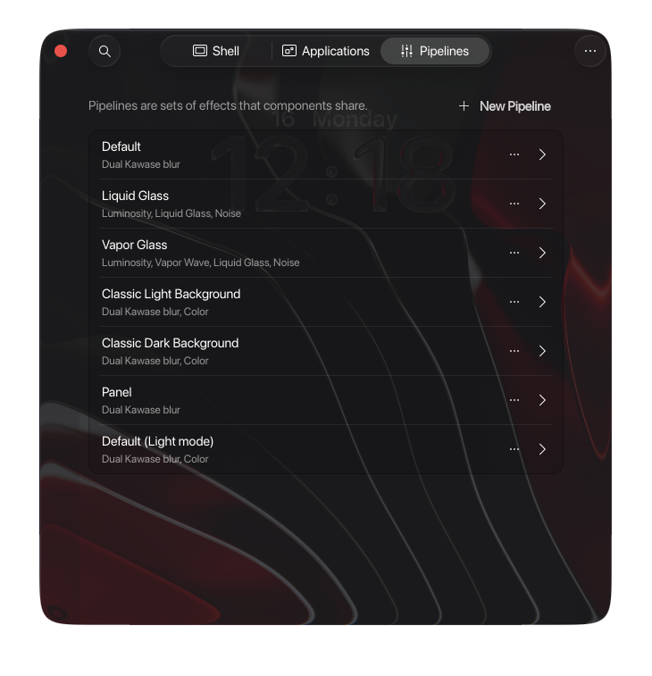
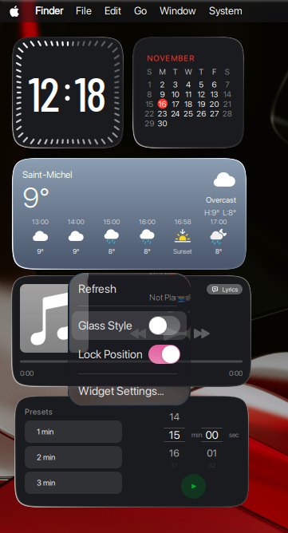
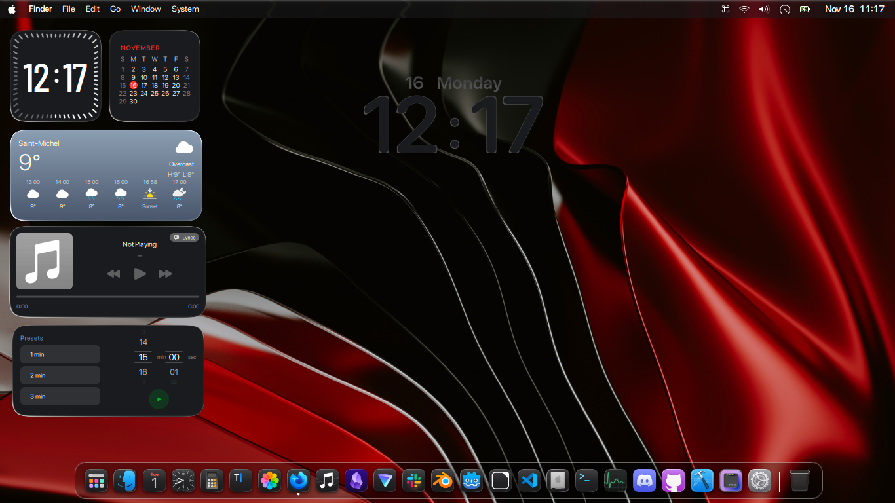

#  macOS 26 "Liquid Glass" — for GNOME

The definitive, highly-polished macOS makeover for modern GNOME desktop environments. 
This isn't just a theme swap—it's a heavily customized pipeline featuring real-time GLSL liquid glass shaders, patched D-Bus global menus, custom squircle icon mappings, and dynamic dark-mode rendering.

## ⚡ Compatibility
This setup relies on modern ECMAScript Module (ESM) extensions and GTK4/Libadwaita overrides.
* **Supported GNOME Versions:** GNOME 45, 46, and 47+ 
* **Supported Distros:** Ubuntu 23.10+, Fedora 39+, Arch Linux, and any rolling release running GNOME 45+
* *(Note: GNOME 44 and older, like Ubuntu 22.04 LTS, are NOT supported due to legacy extension architecture).*

## 🚀 Installation

The automated install scripts will backup your current `dconf` state, download the exact dependencies for your package manager, install the Apple SF fonts, apply the custom icons/themes, and configure the extensions.

**For Ubuntu / Debian:**
`chmod +x install.sh && ./install.sh`

**For Fedora:**
`chmod +x install-fedora.sh && ./install-fedora.sh`

**For Arch Linux:**
`chmod +x install-arch.sh && ./install-arch.sh`

**Post-Install:** Log out and log back in to ensure all GNOME Shell extensions and GLSL shaders activate correctly.

## 🎛️ Customization: Toggling the "Glass" Effect
Not a fan of the full transparent look? You can easily dial back the glass effects to fit your style:

**1. Turn off System-Wide Glass**
Open the **Extension Manager**, find **Blur my Shell**, and you can toggle the global system blur on or off.

**2. Remove Glass on Widgets Only**
We've added a dedicated option to disable the glass effect specifically for desktop widgets if you prefer a solid, clean look.

**Final Result (No Glass Widgets):**

## 🛠️ What's Under the Hood?
* **Base Themes:** Custom forks of MacTahoe-Dark-alt & WhiteSur-Dark
* **Icons:** Patched `MacOS-Like-Dark` with custom root SVGs to prevent light-theme fallback
* **Extensions Included & Configured:** Dash to Dock Lite, Blur my Shell, Compiz alike magic lamp effect, Logo Menu, Space Bar, Just Perfection
* **Browsers:** Includes a `user.js` and custom CSS injection for Firefox to mimic Safari's unified toolbar.

## ☕ Support & Bug Reports
This entire setup is hand-tweaked, patched, and scripted through hours of debugging terminal errors and CSS files. 

If you find any more bugs, run into installation issues, or just need help, feel free to **open an Issue here on GitHub** or shoot me a DM on Instagram: **[@xnoviq](https://instagram.com/xnoviq)**. 

If you like the rice, drop a star on the repo!
