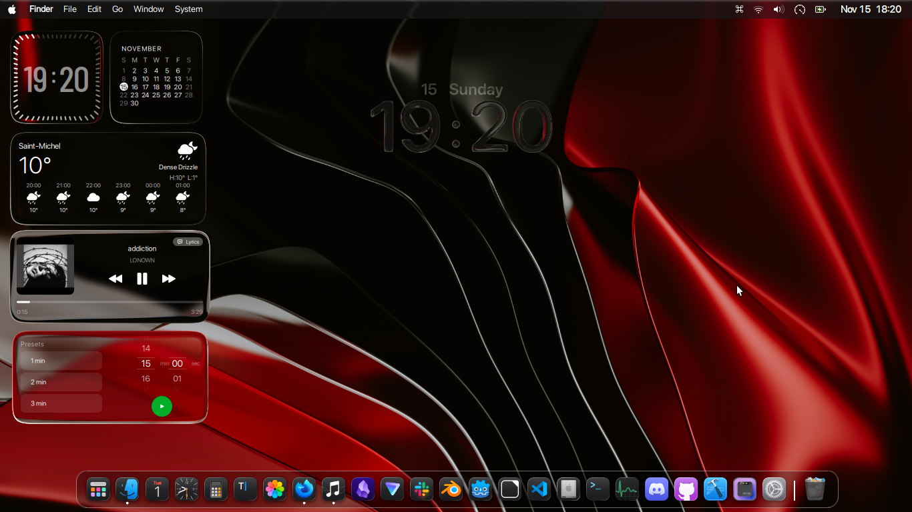
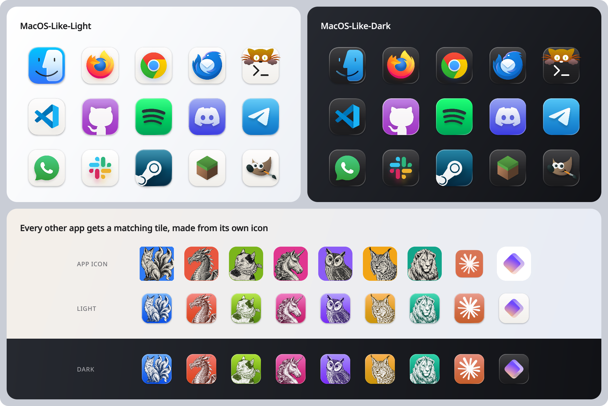
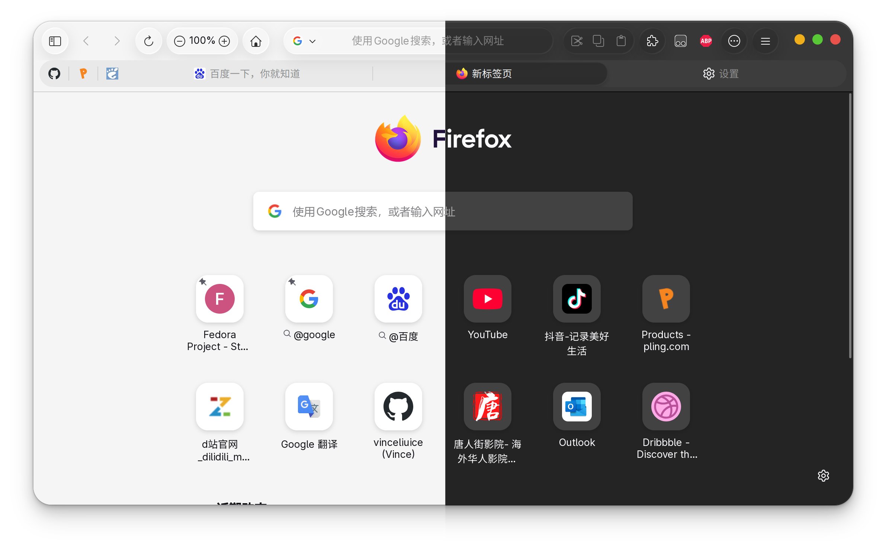
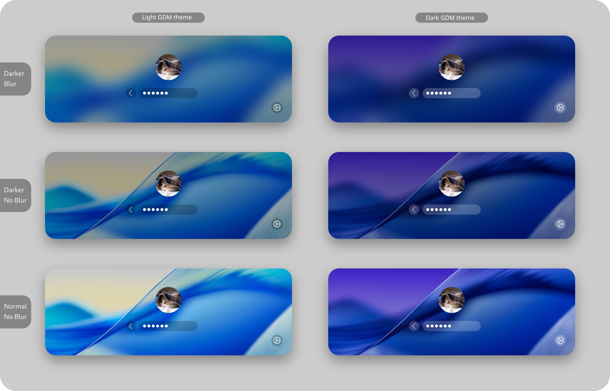

<div align="center">

#  macOS 26 "Liquid Glass" — by xnoviq

### **The Definitive macOS 26 Desktop Architecture for Ubuntu 26.04.1 LTS (GNOME 50.1)**
#### *Engineered, Patched & Packaged by [**@xnoviiq**](https://github.com/xnoviiq)*

<br>

[](https://github.com/xnoviiq)
[](https://ubuntu.com/)
[](https://www.gnome.org/)
[](#)
[](LICENSE)

<br>



<br>

[**🚀 1-Command Install**](#-1-command-installation) • [**🧠 Engineering Breakdown**](#-the-xnoviq-engineering-difference) • [**📸 Visual Showcase**](#-visual-showcase) • [**🎨 Customizer CLI**](#-customizer-cli) • [**💖 Donate**](#-donate--support)

</div>

---

## 🧠 The xnoviq Engineering Difference

99% of "macOS on Linux" guides are superficial theme swaps that fall apart the moment you open a Snap/AppImage, switch keyboard layouts, or upgrade to GNOME 50.1.

**macOS 26 by [@xnoviiq](https://github.com/xnoviiq)** is not a basic theme pack—it is a deeply patched, full-stack GNOME 50.1 transformation. Every annoying Linux desktop papercut was hunted down and solved at the **JavaScript, GLSL shader, CSS, and SVG geometry level**:

| Subsystem | Standard Linux Rice | **macOS 26 by xnoviq (@xnoviiq)** |
| :--- | :--- | :--- |
| **Optical Refraction** | Flat Gaussian blur | **Custom GLSL Liquid Glass Pipeline** (`refraction` + `luminosity` + `edge_glow` + `rgb_fringing`) paired with a **72% alpha VTE Terminal** so windows and terminals refract underlying pixels in real time |
| **Top Panel & Global Menu** | Static workspace indicator | **Patched D-Bus Global Menu (`Orbit` + `ShiroOSL`)** that maps the desktop & Nautilus to **Finder** and hard-locks the Apple System Menu to `index 0` |
| **Keyboard Indicator** | Ugly `en` / `fr` raw text string | **xnoviq Self-Healing `⌘` Patch** — hooks `St.Label` visibility signals in GNOME Shell to suppress raw text and inject a native `⌘` icon while keeping the switcher menu 100% functional |
| **Dock & Launchpad** | Stock 9-dot GNOME grid & oversized Trash | **Custom Dark macOS Launchpad Icon**, `animator.js` crash fixes, pre-arranged App Grid, and an automated **22% SVG `viewBox` baseline scaler** so the Trash icon aligns with every app squircle |
| **Snap & AppImage Icons** | Broken / low-res default icons | **Persistent `.desktop` Override Layer** that forces uniform macOS squircles across Obsidian, GitHub Desktop, Liner, Wireshark, and LibreOffice |
| **Typography & Controls** | Default Ubuntu Sans & stock buttons | **Complete Apple SF Pro Display / Text / Mono Suite** + **2nd-Gen (`-alt`) macOS Traffic Light Controls** pre-linked across GTK3, GTK4, and Libadwaita |

---

## 📸 Visual Showcase

| 🔮 Liquid Glass Desktop & Interactive Widgets | 🚀 Custom Dark Launchpad & Squircle Icon Pack |
| :---: | :---: |
|  |  |
| *Real-time refraction widgets, global menu bar & dark red material aesthetic* | *Full-color macOS Launchpad icon & uniform squircle overrides across all apps* |

| 🧭 Safari 26 Firefox (Light & Dark Adaptive) | 🔒 macOS Lock Screen & GDM Styling |
| :---: | :---: |
|  |  |
| *Left-aligned traffic lights, unified URL pill & compact rounded tabs* | *Matching macOS Tahoe / Liquid Glass lock screen & login variants* |

---

## 🚀 1-Command Installation

Deploy the complete **xnoviq macOS 26** environment on a fresh **Ubuntu 26.04.1 LTS (GNOME 50.1)** setup in one command. Your previous `dconf` configuration is automatically backed up to `~/.config/macos26-backup/` before installation:

```bash
git clone https://github.com/xnoviiq/MacOS-26-Gnome.git
cd macos-26-gnome
chmod +x install.sh
./install.sh
```

> [!IMPORTANT]
> **Log out and log back in** (or press `Alt + F2` → `r` on X11) once `./install.sh` finishes so GNOME Shell loads all newly installed extensions, GLSL shaders, SF Pro fonts, and icon caches cleanly.

<details>
<summary><b>🔄 Want to revert to stock Ubuntu? (1-Click Rollback)</b></summary>

<br>

Run the bundled uninstaller to restore your automatic pre-install `dconf` backup and re-enable the default Ubuntu Dock:

```bash
./uninstall.sh
```

</details>

---

## 🎨 Customizer CLI

Included in the root of the repository is `./customize-mactahoe.sh` (backed by `tools/MacTahoe-gtk-theme/`), allowing you to switch system accent colors, toggle traffic light styles, or re-apply the Safari Firefox theme anytime:

```bash
# Re-apply xnoviq default (Dark mode + 2nd-style traffic lights + Libadwaita link)
./customize-mactahoe.sh -c dark -a alt -l

# Switch system accent color (blue | purple | pink | red | orange | yellow | green | grey)
./customize-mactahoe.sh -c dark -t blue -a alt -l

# Re-apply or update the Safari Firefox userChrome theme
./tools/MacTahoe-gtk-theme/tweaks.sh -f
```

---

## ⌨️ Shortcuts & Desktop Workflow

| Action | Trigger / Shortcut | Engineered Component |
| :--- | :--- | :--- |
| **Spotlight Search** | `Super + Space` (or click 🔍 in Top Bar) | `spotlight@nin` |
| **macOS Launchpad (App Grid)** | Click the **Dark Launchpad** icon on the Dock | `dash2dock-lite` (xnoviq Patched) |
| **Switch Input Layout** | Click the **`⌘`** icon in the Top Bar | `Orbit Global Menu` (xnoviq Patched) |
| **Desktop Widgets** | Right-click any desktop widget | `liquidglass-widgets` |
| **Magic Lamp Minimize** | Click yellow minimize traffic light | `compiz-alike-magic-lamp` |

---

## 📂 Repository Architecture

<details>
<summary><b>Click to inspect the directory tree & bundled patches</b></summary>

<br>

```text
macos-26-gnome/
├── install.sh                 # 1-Click automated installer by xnoviq (auto-detects display & backs up dconf)
├── uninstall.sh               # 1-Click rollback script
├── customize-mactahoe.sh      # Interactive CLI wrapper for theme & accent customization
├── configs/                   # Sanitized dconf dumps, GTK-3.0/4.0 CSS & Terminal alpha profiles
├── fonts/                     # Full Apple SF Pro Display, SF Pro Text & SF Mono font suite
├── themes/                    # Pre-compiled MacTahoe-Dark-alt (GTK) & WhiteSur-Dark (Shell)
├── icons/                     # MacOS-Like-Dark, custom Dark Launchpad icon & squircle overrides
├── extensions/                # Patched Orbit Global Menu, ShiroOSL, Dash2Dock-Lite, Blur My Shell, etc.
├── applications/              # Snap/AppImage-persistent .desktop icon mappings
├── wallpapers/                # High-resolution macOS & dark material wallpapers
├── firefox/                   # Safari 26 userChrome.css & user.js profile configuration
└── tools/MacTahoe-gtk-theme/  # Full upstream MacTahoe customization & tweaks toolkit
```

</details>

---

## 🏆 Author & Credits

* **Lead Architect & Patch Engineer:** [**xnoviq (@xnoviiq)**](https://github.com/xnoviiq)
* **Upstream Foundations:** Built on top of open-source components from [vinceliuice/MacTahoe-gtk-theme](https://github.com/vinceliuice/MacTahoe-gtk-theme), [WhiteSur-gtk-theme](https://github.com/vinceliuice/WhiteSur-gtk-theme), [Niwmua/liquidglass-gnome-widgets](https://github.com/Niwmua/liquidglass-gnome-widgets), [aunetx/blur-my-shell](https://github.com/aunetx/blur-my-shell), [icedman/dash2dock-lite](https://github.com/icedman/dash2dock-lite), and [unmade/global-menu](https://github.com/unmade/global-menu).

---

## 💖 Donate & Support

If **macOS 26 "Liquid Glass" by xnoviq** saved you hours of tweaking and transformed your Ubuntu desktop, consider supporting the project or reaching out directly for donations!

<div align="center">

[](https://instagram.com/xnoviq)
[](https://github.com/xnoviiq)

**📸 Instagram (DM to Donate / Support): [@xnoviq](https://instagram.com/xnoviq)**

*Architected with precision by **xnoviq** — Drop a ⭐ on the repository if you love the setup!*

</div>
