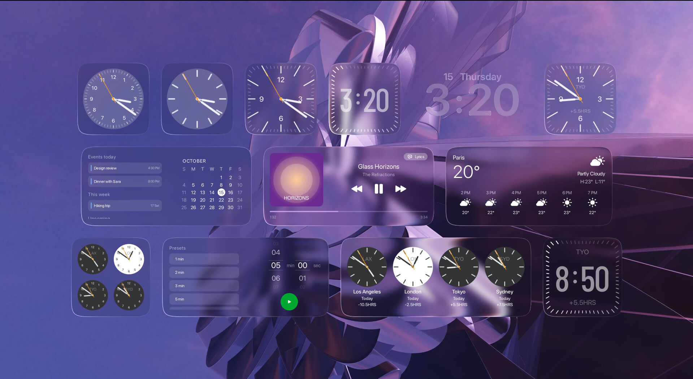

# macOS 26 "Liquid Glass" for Ubuntu GNOME

A lightweight, one-command macOS 26 desktop setup for Ubuntu 26.04.1 LTS (GNOME 50.1).

 

 

 

[**1-Command Install**](#-1-command-installation) • [**What's Fixed**](#-whats-included--fixed) • [**Screenshots**](#-visual-showcase) • [**Customizer CLI**](#-customizer-cli) • [**Donate & Support**](#-donate--support)

---

## Why I Built This

Most macOS GNOME guides are quick theme swaps that fall apart the moment you open a Snap or AppImage, switch keyboard layouts, or update to GNOME 50.1. They also tend to lag on older laptops.

I daily-drive an 8th-gen Intel i3 laptop with integrated graphics, so I put together a complete, working setup that fixes those GNOME papercuts and runs smoothly at 60fps in a single install script.

---

## What's Included & Fixed

- **Liquid Glass Blur & Terminal:** Custom GLSL refraction shaders paired with a 72% transparent VTE terminal.
- **Top Panel & Global Menu:** Patched D-Bus Global Menu (`Orbit` + `ShiroOSL`) that maps Nautilus and the desktop to **Finder** and keeps the Apple menu pinned to the far left.
- **Keyboard Indicator Fix:** Hooks `St.Label` visibility signals in GNOME Shell to replace raw `en` / `fr` text with a clean `⌘` icon while keeping layout switching working.
- **Dock & Launchpad:** Custom dark macOS Launchpad icon, `animator.js` crash fixes, pre-arranged app grid, and an automated SVG `viewBox` scaler so the Trash icon matches app squircle proportions.
- **Snap & AppImage Icons:** Persistent `.desktop` icon overrides so apps like Obsidian, GitHub Desktop, Liner, Wireshark, and LibreOffice keep proper macOS squircles.
- **Fonts & Window Controls:** Apple SF Pro Display, Text, and Mono fonts paired with 2nd-gen (`-alt`) macOS traffic light buttons across GTK3, GTK4, and Libadwaita.

---

## Visual Showcase

| Liquid Glass Desktop & Widgets | Custom Dark Launchpad & Squircle Icons |
| :---: | :---: |
|  |  |
| *Real-time refraction widgets, global menu bar & dark red material aesthetic* | *Full-color macOS Launchpad icon & uniform squircle overrides across apps* |

| Safari 26 Firefox (Light & Dark Adaptive) | macOS Lock Screen & GDM Styling |
| :---: | :---: |
|  |  |
| *Left-aligned traffic lights, unified URL pill & compact rounded tabs* | *Matching macOS Tahoe / Liquid Glass lock screen & login variants* |

---

## 1-Command Installation

Deploy the setup on **Ubuntu 26.04.1 LTS (GNOME 50.1)**. Your existing `dconf` settings are automatically backed up to `~/.config/macos26-backup/` before anything is changed:

    git clone https://github.com/xnoviiq/MacOS-26-Gnome.git
    cd MacOS-26-Gnome
    chmod +x install.sh
    ./install.sh

> **Note:** Log out and log back in (or press `Alt + F2` then `r` on X11) once `./install.sh` finishes so GNOME Shell reloads all extensions, shaders, fonts, and icon caches cleanly.

<b>Want to revert to stock Ubuntu? (1-Click Rollback)</b>

 

Run the bundled uninstaller to restore your pre-install `dconf` backup and re-enable the default Ubuntu Dock:

    ./uninstall.sh

---

## Customizer CLI

Included in the root of the repo is `./customize-mactahoe.sh` (backed by `tools/MacTahoe-gtk-theme/`), so you can switch accent colors, toggle traffic light styles, or re-apply the Safari Firefox theme anytime:

    # Re-apply default (Dark mode + 2nd-style traffic lights + Libadwaita link)
    ./customize-mactahoe.sh -c dark -a alt -l

    # Switch system accent color (blue | purple | pink | red | orange | yellow | green | grey)
    ./customize-mactahoe.sh -c dark -t blue -a alt -l

    # Re-apply or update the Safari Firefox userChrome theme
    ./tools/MacTahoe-gtk-theme/tweaks.sh -f

---

## Shortcuts & Desktop Workflow

| Action | Trigger / Shortcut | Component |
| :--- | :--- | :--- |
| **Spotlight Search** | `Super + Space` (or click 🔍 in Top Bar) | `spotlight@nin` |
| **macOS Launchpad (App Grid)** | Click the **Dark Launchpad** icon on the Dock | `dash2dock-lite` (Patched) |
| **Switch Input Layout** | Click the **`⌘`** icon in the Top Bar | `Orbit Global Menu` (Patched) |
| **Desktop Widgets** | Right-click any desktop widget | `liquidglass-widgets` |
| **Magic Lamp Minimize** | Click yellow minimize traffic light | `compiz-alike-magic-lamp` |

---

## Repository Structure

<b>Click to inspect the directory tree</b>

 

    MacOS-26-Gnome/
    ├── install.sh                 # 1-Click automated installer (auto-detects display & backs up dconf)
    ├── uninstall.sh               # 1-Click rollback script
    ├── customize-mactahoe.sh      # Interactive CLI wrapper for theme & accent customization
    ├── configs/                   # Sanitized dconf dumps, GTK-3.0/4.0 CSS & Terminal alpha profiles
    ├── fonts/                     # Apple SF Pro Display, SF Pro Text & SF Mono fonts
    ├── themes/                    # Pre-compiled MacTahoe-Dark-alt (GTK) & WhiteSur-Dark (Shell)
    ├── icons/                     # MacOS-Like-Dark, custom Dark Launchpad icon & squircle overrides
    ├── extensions/                # Patched Orbit Global Menu, ShiroOSL, Dash2Dock-Lite, Blur My Shell, etc.
    ├── applications/              # Snap/AppImage-persistent .desktop icon mappings
    ├── wallpapers/                # High-resolution macOS & dark material wallpapers
    ├── firefox/                   # Safari 26 userChrome.css & user.js profile configuration
    └── tools/MacTahoe-gtk-theme/  # Upstream MacTahoe customization & tweaks toolkit

---

## Roadmap

- [x] macOS 26 Tahoe (Liquid Glass) edition
- [ ] macOS Sequoia edition
- [ ] macOS Sonoma edition

---

## Author & Credits

- **Maintainer:** [xnoviq (@xnoviiq)](https://github.com/xnoviiq)
- **Upstream Projects:** Built on top of open-source work from [vinceliuice/MacTahoe-gtk-theme](https://github.com/vinceliuice/MacTahoe-gtk-theme), [WhiteSur-gtk-theme](https://github.com/vinceliuice/WhiteSur-gtk-theme), [Niwmua/liquidglass-gnome-widgets](https://github.com/Niwmua/liquidglass-gnome-widgets), [aunetx/blur-my-shell](https://github.com/aunetx/blur-my-shell), [icedman/dash2dock-lite](https://github.com/icedman/dash2dock-lite), and [unmade/global-menu](https://github.com/unmade/global-menu).

---

## Donate & Support

This project is completely free and open-source. I'm an independent student developer building and testing everything on an older 8th-gen i3 laptop—so if this saved you hours of tweaking or made your Ubuntu desktop feel brand new, supporting the project directly helps me keep maintaining it and building the Sequoia and Sonoma versions.

**Instagram (DM to Donate / Support): [@xnoviq](https://instagram.com/xnoviq)**

*Drop a ⭐ on the repository if you like the setup!*

